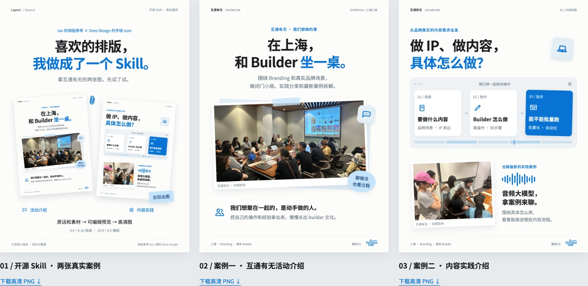
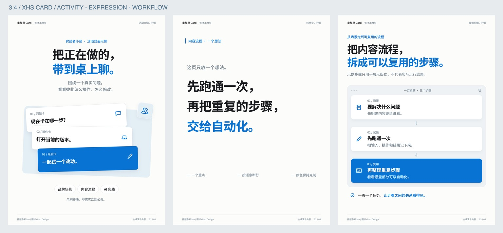
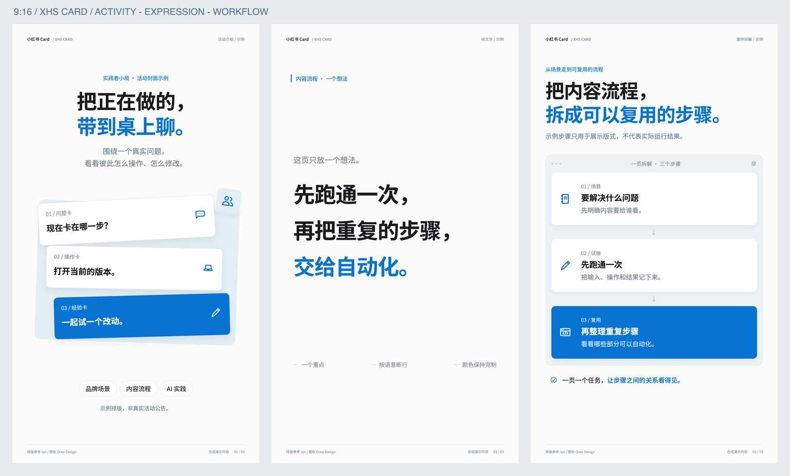
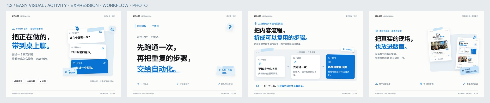

# 省心出图 · shengxin-chutu

把原话和素材，做成轮播、长卡，或者 Keynote 式 deck。

主命令为 `$shengxin-chutu`，旧命令 `$xhs-card` 保留兼容。GitHub 仓库地址继续使用 `xhs-card`。

蓝白黑、思源黑体、手绘 icon、轻 UI 层次。支持 **3:4、9:16、16:9、4:3**；换比例时重新排版，不拉伸原图。

[查看定稿真实案例](shengxin-chutu/assets/approved-cases/index.html) · [打开 Playground](https://derek-zhuolin.github.io/xhs-card/shengxin-chutu/assets/playground/index.html) · [Reference 与致敬](NOTICE.md) · [Skill 入口](shengxin-chutu/SKILL.md)

## 先说参考从哪来

我很喜欢 **Ian（伊恩）** 的排版，也喜欢 **Oreo Design** 的手绘小图标。这个 Skill 是我把喜欢的部分放到一起，再按自己的使用习惯一点点调整的结果。

- 排版参考：[Ian XHS Carousel](https://github.com/helloianneo/ian-xhs-carousel)，感谢 Ian 对标题、留白和产品界面式排版的分享。
- 手绘图标：[Oreo Design / Doodle Icons](https://github.com/oreo-design/doodle-icons)，采用静态 SVG，保留原路径和 MIT 许可；版权署名 Nicole Tang。
- 字体：[Adobe / Google · 思源黑体](https://github.com/adobe-fonts/source-han-sans)，保留 OFL 许可。

我做的主要是组合、整理和实践：补上个人文案的编辑尺度、蓝白黑组件规则、多比例重排、Playground 和导出流程。希望这些参考能让你少从一张空白画布开始。也欢迎先去看看原作者的作品。

## 看实际效果

先看这次确认的三张真实案例，后续视觉以这组为参考：真实现场照片、Builder 表达、手绘 icon 与轻 UI 层次。



[查看完整大图与下载](https://derek-zhuolin.github.io/xhs-card/shengxin-chutu/assets/approved-cases/index.html) · [案例说明](shengxin-chutu/references/approved-cases.md)

下面保留四种比例的模板示例。活动、表达、流程页使用合成内容；图文素材板引用已确认的真实案例。文案和素材可替换。

### 3:4 · 小红书轮播

1080×1440 逻辑画布，默认导出 2160×2880。适合活动封面、个人表达、步骤拆解。



### 9:16 · 竖屏长卡

1080×1920 逻辑画布，默认导出 2160×3840。和3:4同属竖版卡片，标题、步骤与间距分别重排。



### 16:9 · Keynote 式 deck

1600×900 逻辑画布，默认导出 3200×1800。横向组织标题、案例与模块，也可以让一个观点占满整页。


### 4:3 · 横版 deck 的紧凑比例

1200×900 逻辑画布，默认导出 2400×1800。适合传统投影或更紧凑的横向资料页；减少横向并列，重新断行。



## 怎么装

复制 `shengxin-chutu/` 文件夹到你的 Agent 的 Skill 目录。例如 Codex：

```sh
git clone https://github.com/derek-zhuolin/xhs-card.git
mkdir -p ~/.codex/skills
cp -R ./xhs-card/shengxin-chutu ./xhs-card/xhs-card ~/.codex/skills/
```

上面同时安装主包和旧命令兼容入口；主包自带字体、图标、模板和脚本。已有同名 Skill 时先保留自己的修改，再合并新版本。

## 怎么叫它来做

小红书轮播：

```text
用 $shengxin-chutu，把下面这段原话和照片做成 3 张小红书轮播。
3:4，蓝白黑，保留我的语气。
```

宽屏演示：

```text
用 $shengxin-chutu，做成一套 16:9 的 Keynote 式 deck。
标题、案例、观点页的排版有变化，先用 Playground 看。
```

竖屏长卡：

```text
用 $shengxin-chutu，改成 9:16 的竖屏长卡。
流程步骤上下排，保持字号和清楚的组件间距。
```

传统横版：

```text
用 $shengxin-chutu，把这套 deck 改成 4:3。
重新断行和组织模块，文字不要缩得很小。
```

定稿同步：

```text
这段是最终正文，不要润色。原样同步到正文文件、预览与下载包。
```

轻编辑保留作者的判断、具体观察和语气。定稿锁定后，字、标点、空格和分段都保持。具体规则见 [作者语气](shengxin-chutu/references/profiles/author-voice.md) 和 [文本保真](shengxin-chutu/references/standards/text-sync.md)。

## Playground

[在线体验](https://derek-zhuolin.github.io/xhs-card/shengxin-chutu/assets/playground/index.html) 按竖版卡片（3:4、9:16）和横版 deck（16:9、4:3）分组，可切换比例、案例、平面/轻浮起层次，支持缩略图跳转、方向键翻页和全屏。也可直接打开本地 `index.html`，完全使用随包字体与图标。

HTML/CSS 源稿可编辑；PNG 是出图结果。Keynote 式指排版方向，不代表已经生成原生 `.key` 文件。整页图片组成的 PPTX 要注明图版，不能称文字原生可编辑。

## 本地重新导出

需要 Node.js 18+；线上冒烟还使用 curl。首次安装依赖和 Chromium：

```sh
npm install
npx playwright install chromium
npm run render
npm run verify
npm run smoke
```

生成四种比例各四页 PNG，以及每种比例和整组总览。字体和图标离线随包。在线预览优先加载随包的轻量字体子集，新字符可回退到完整思源黑体；改文案后可运行 `python3 shengxin-chutu/scripts/subset-fonts.py .` 更新子集，避免为少数字额外加载完整字体（需 fontTools、brotli）。可用 `CHROMIUM_EXECUTABLE` 指定已有浏览器，`NODE_PATH` 指定已有依赖。

流程页会把说明、步骤与总结放成连续的一组；组件之间留出间隔。纯文字页通过字号与颜色分层，没有引用关系时不加装饰性大引号。

## 规则怎么分

|层|内容|
|---|---|
|通用标准|素材来源、原文保真、版本、字体加载、导出与校验|
|可替换偏好|作者语气、署名、照片、比例和页数；默认蓝白黑视觉|
|每篇独有|个人经历、事实、观点、为什么喜欢或是否值得，不从示例推定|

- [3:4 / 9:16 / 16:9 / 4:3 的参数与重排](shengxin-chutu/references/formats/aspect-ratios.md)
- [轮播排版](shengxin-chutu/references/formats/carousel.md) / [deck 排版](shengxin-chutu/references/formats/deck.md)
- [字体、icon、阴影与粘土点缀](shengxin-chutu/references/profiles/interflow-visual.md)
- [Reference 与致敬](NOTICE.md)

## License

本项目代码与文档采用 [MIT](LICENSE)。第三方图标保留 [Oreo Design / Nicole Tang 的 MIT 许可](shengxin-chutu/assets/icons/LICENSE)，字体保留 [OFL 许可](shengxin-chutu/assets/fonts/OFL.txt)。参考作品的归属见 NOTICE；公开包没有包含原作者截图或私人原稿。`shengxin-chutu/assets/approved-cases/` 中的真实照片与品牌内容经作者确认用于展示，不纳入代码 MIT 许可，复用时请换成自己的素材。


## 站点结构化数据

首页使用 `WebSite`、`WebPage` 和 `SoftwareSourceCode` 描述真实的开源项目；Playground 和真实案例页使用 `CollectionPage`、`ItemList`，案例图片使用 `ImageObject`。没有虚构评分、评论、价格、活动日期或使用人数。

[结构化数据字段与依据](docs/structured-data.md)。中文展示名为「省心出图」，主命令为 `shengxin-chutu`，GitHub 仓库保留 `xhs-card`。


线上冒烟（替换为你的 Pages URL）：

```sh
SITE_URL=https://derek-zhuolin.github.io/xhs-card/ npm run smoke
```

检查首页、schema、手机布局、四比例共 16 张图、下载尺寸、翻页、图层、全屏与旧链接兼容。报告默认写入系统临时目录，不写入公开仓库。

[本次发布验证记录](docs/verification.md)：三页官方 schema 检测与完整线上冒烟结果。
